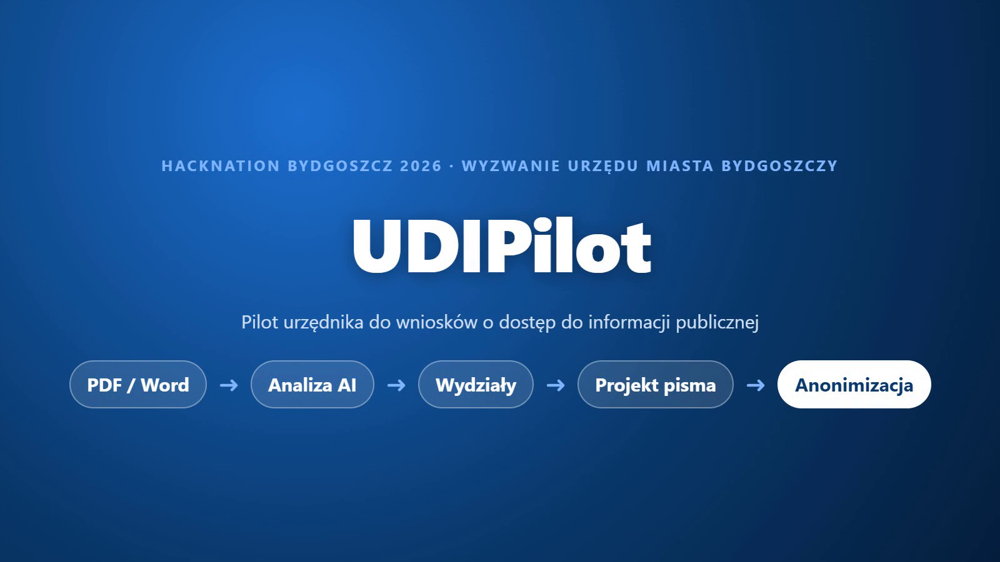
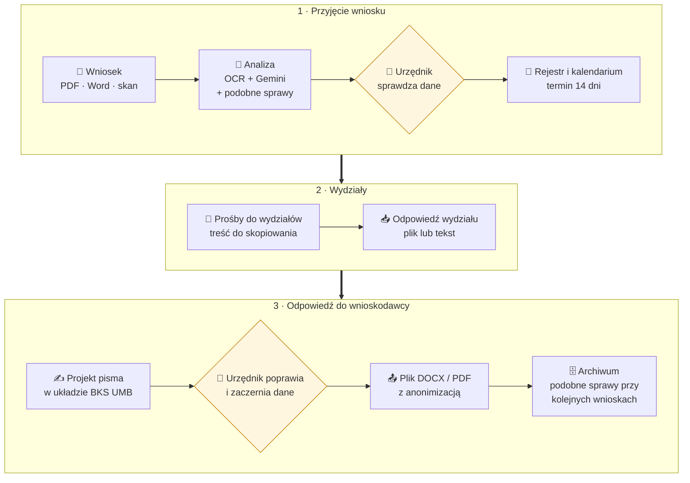
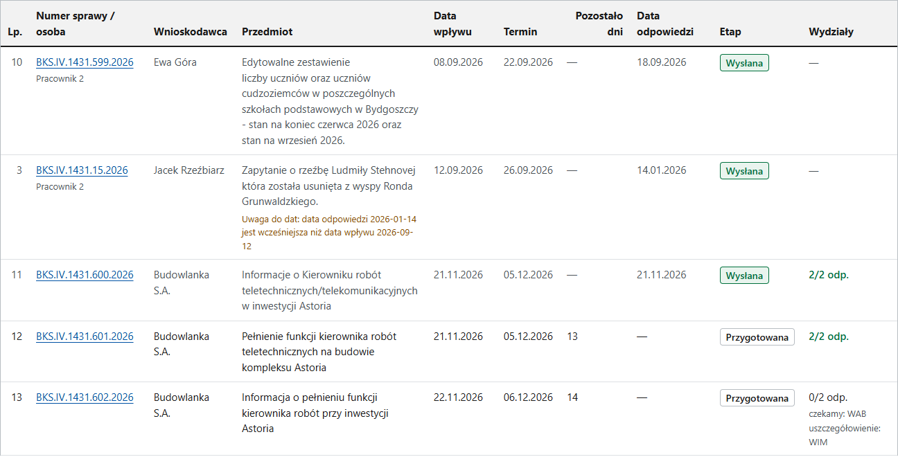
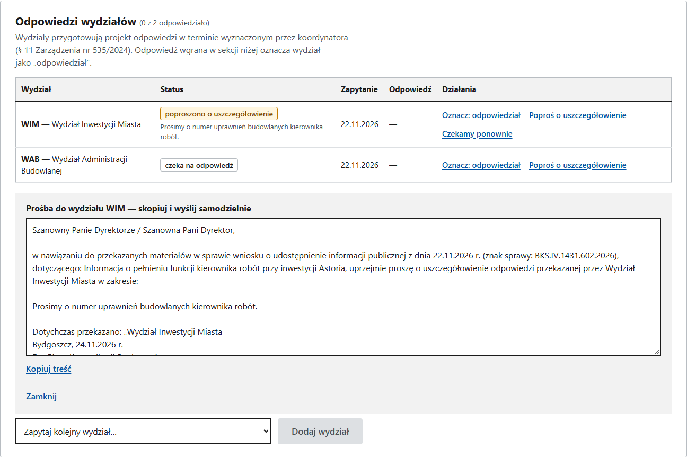
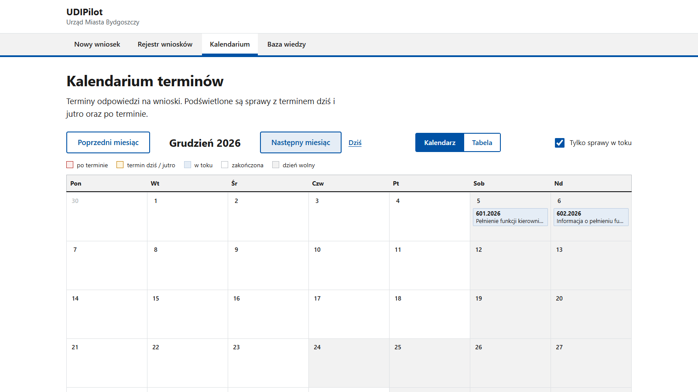
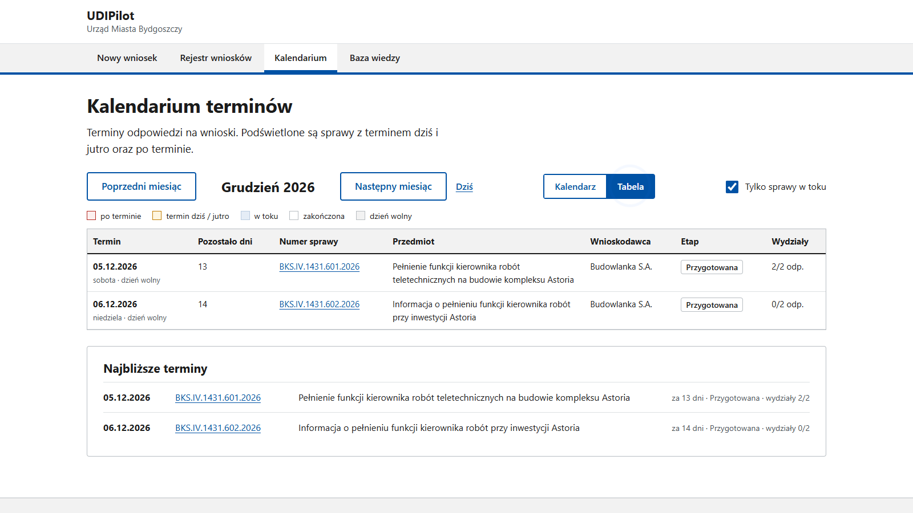
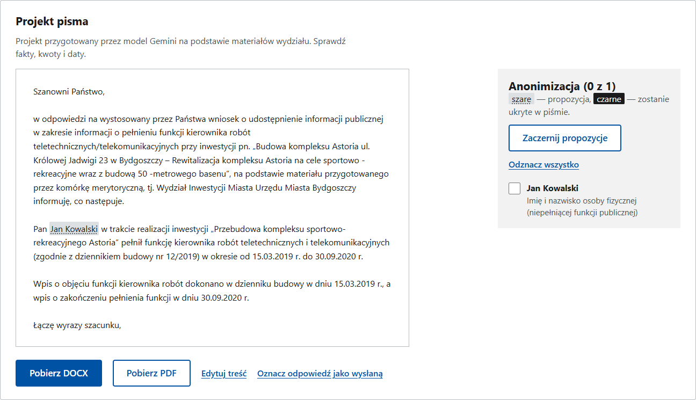
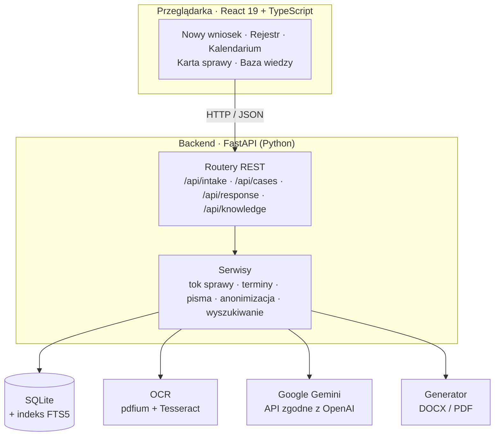
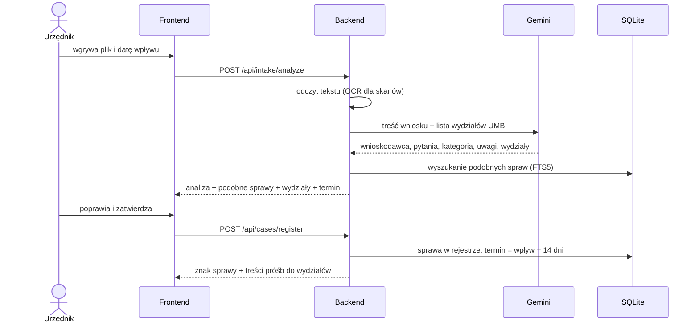
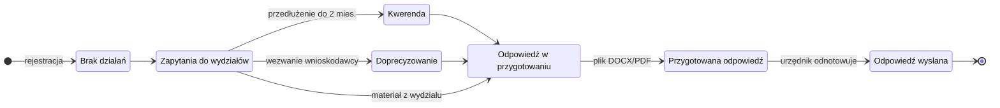

# UDIPilot · Urząd Miasta Bydgoszczy

**Inteligentny asystent urzędnika do wniosków o dostęp do informacji publicznej** — Hacknation Bydgoszcz 2026.

Urzędnik wgrywa wniosek (PDF, Word albo skan). Asystent go odczytuje i streszcza, znajduje podobne sprawy
w archiwum, wskazuje właściwe wydziały i pilnuje terminu. Z odpowiedzi wydziałów przygotowuje projekt
pisma w układzie urzędu, a dane osobowe proponuje do zaczernienia.

### ▶ Film: UDIPilot w praktyce (1:31)

[](docs/demo/udipilot-film.mp4)

Wgranie wniosku PDF → analiza Gemini → rejestracja → **statusy wydziałów i prośba o uszczegółowienie** →
odpowiedź wydziału (Word) → projekt pisma → anonimizacja → gotowy PDF → **spis spraw z etapami** →
**kalendarz i widok tabelaryczny**. [Pobierz film (MP4)](docs/demo/udipilot-film.mp4)

> **Zasada nadrzędna:** asystent niczego nie wysyła i niczego nie rozstrzyga sam. Każda propozycja —
> wydziały, termin, treść pisma, anonimizacja — czeka na decyzję urzędnika.

---

## Jak to działa — w jednym diagramie



Pomarańczowe romby to momenty decyzji człowieka. Każda wysłana odpowiedź (już zanonimizowana) trafia
do archiwum i pomaga przy następnych podobnych wnioskach — w kroku „Analiza”.

---

## Co widzi urzędnik

**Spis spraw z etapem każdej sprawy** — od najstarszych, terminy i pozostałe dni, etap, kto z wydziałów odpowiedział:



**Statusy wydziałów** — kto odpowiedział, na kogo czekamy; prośba o uszczegółowienie także do wydziału, który
już odpowiedział, ale niewystarczająco (treść gotowa do skopiowania, status zmienia się sam):



| Kalendarz terminów z dniami wolnymi | Ten sam miesiąc w widoku tabelarycznym |
|---|---|
|  |  |

**Projekt pisma z anonimizacją** — szare podświetlenie to propozycja, czarne to fragment zaakceptowany do ukrycia:



---|---|
|  |  |

**Projekt pisma z anonimizacją** — szare podświetlenie to propozycja, czarne to fragment zaakceptowany do ukrycia:


**Odpowiedzi wydziałów** — kto odpowiedział, na kogo czekamy, prośba o uszczegółowienie:


---

## Wymagania wyzwania → co zostało zrobione

| Wymaganie | Realizacja |
|---|---|
| Wgrywanie PDF / Word | PDF, DOCX, DOC oraz skany JPG/PNG/TIFF z OCR po polsku. Gdy skan jest nieczytelny (pismo odręczne), system prosi o przepisanie treści zamiast zgadywać. |
| Kalendarz wniosków od najstarszych, podświetlenie dziś/jutro | Rejestr z kolumnami arkusza UMB, wyborem roku i wyszukiwaniem, podświetleniem: **po terminie** (czerwień), **dziś/jutro** (bursztyn). Do tego kalendarium miesięczne. |
| Statusy: w przygotowaniu, kwerenda, wysłana, inicjały, daty | Etapy sprawy, przedłużenie terminu do 2 miesięcy (art. 13 ust. 2 u.d.i.p.) z kontrolą limitu, statusy odpowiedzi każdego wydziału. |
| Anonimizacja: szary → czarny po akceptacji | 28 kategorii z wytycznych UMB (wzorce + model). Maski nakłada serwer w pliku i w archiwum. |
| Przeszukiwanie archiwum | Podobne sprawy wyszukiwane pełnotekstowo (SQLite FTS5) przy każdym nowym wniosku. |
| Wskazywanie ścieżki do wydziałów | Propozycja komórek UMB z uzasadnieniem i podpowiedź, gdy urząd nie jest dysponentem informacji. |
| Projekt odpowiedzi z materiałów wydziałów | Pismo w układzie BKS („Ad 1…”). Brakujące informacje oznaczone `[DO UZUPEŁNIENIA]` zamiast zmyślonych. |
| Brak automatycznej wysyłki | System nic nie wysyła — prośby i pisma urzędnik kopiuje lub pobiera, a wysyłkę tylko odnotowuje. |
| Docelowo model zamknięty, bez Internetu | Klient modelu korzysta z API zgodnego z OpenAI; inny, lokalny model podłącza się zmianą `LLM_BASE_URL`, bez zmian w kodzie. `OFFLINE_MODE=true` blokuje wysyłkę treści na zewnątrz. |
| „Uczenie się” na ustawach i odpowiedziach | Baza wiedzy: import ustaw i zarządzeń (dzielone na artykuły i paragrafy), import rejestru z Excela, archiwum odpowiedzi — trafiają do promptu od razu, bez trenowania. |

---

## Architektura



- **Jedno źródło reguł.** Terminy ustawowe, dni wolne (święta liczone z daty Wielkanocy), limity plików
  i maskowanie danych liczy wyłącznie backend; interfejs pobiera je przez API.
- **Model tylko tam, gdzie potrzebny.** Gemini streszcza wniosek i pisze projekt odpowiedzi. Terminy,
  wyszukiwanie, szablony pism, wzorce anonimizacji i statusy działają deterministycznie.
- **Dane.** SQLite z migracjami schematu; indeks pełnotekstowy aktualizują triggery.

### Co dzieje się po wgraniu wniosku



### Etapy sprawy



---

## Uruchomienie

**Wymagania:** Docker z Docker Compose oraz klucz API Gemini
([aistudio.google.com/apikey](https://aistudio.google.com/apikey), darmowy).

```bash
git clone https://github.com/GPrzyborowski/hacknation-bydgoszcz-2026.git
cd hacknation-bydgoszcz-2026
cp .env.example .env            # wpisz GEMINI_API_KEY=...
docker compose up --build
```

| Usługa | Adres |
|---|---|
| Aplikacja | http://localhost:5173 |
| Dokumentacja API (Swagger) | http://localhost:8000/docs |

Przy pierwszym starcie baza wczytuje **10 spraw z rejestru testowego UMB** (wnioski, odpowiedzi, pisma kwerendy
i doprecyzowania) oraz **Zarządzenie nr 535/2024** — od razu jest co oglądać. Aby zacząć od nowa, usuń
`backend/app/data/udip.db` i uruchom ponownie.

### Szybki test (2 minuty)

1. **Rejestr wniosków** — sprawy testowe UMB, wyszukaj „Astoria”.
2. **Nowy wniosek** — wgraj `Wniosek - BKS.IV.1431.590.2026.pdf` z materiałów wyzwania → po kilku sekundach
   analiza, podobne sprawy i propozycja wydziałów WIM i WAB → **Zarejestruj wniosek**.
3. **Karta sprawy** → *Odpowiedź z wydziału* — wklej treść odpowiedzi wydziału → projekt pisma.
4. **Zaczernij propozycje** → **Pobierz DOCX** — w pliku zamiast danych osobowych stoi `[ANONIMIZACJA]`.

Pełny scenariusz pokazu i opis wymagań: [docs/PREZENTACJA.md](docs/PREZENTACJA.md).

### Najważniejsze ustawienia (`.env`)

| Zmienna | Domyślnie | Znaczenie |
|---|---|---|
| `GEMINI_API_KEY` | — | klucz Gemini (wymagany) |
| `LLM_MODEL` | `gemini-2.5-flash` | model Gemini |
| `OFFLINE_MODE` | `false` | `true` blokuje wysyłkę treści do modelu |
| `CASE_NUMBER_PREFIX` | `BKS.IV.1431` | prefiks nadawanego znaku sprawy |
| `DEADLINE_SHIFT_TO_WORKING_DAY` | `false` | przesuwanie terminu z dnia wolnego (art. 57 § 4 KPA) |

Pełna lista: [backend/README.md](backend/README.md).

---

## Struktura repozytorium

```
backend/
  app/
    routers/       endpointy REST (cienkie — wywołują serwisy)
    services/      logika: tok sprawy, terminy, pisma, anonimizacja, OCR, Gemini, wyszukiwanie
    seed/          dane testowe UMB wczytywane przy pierwszym starcie
    domain.py      statusy spraw, rodzaje pism, statusy wydziałów
    db.py          schemat, migracje, indeks FTS5
  scripts/         budowa danych testowych, eksport specyfikacji OpenAPI
frontend/src/
  views/           ekrany: intake/ (nowy wniosek), case/ (karta sprawy), rejestr, kalendarium, baza wiedzy
  components/      elementy wspólne: strefa upuszczania pliku, komunikaty, przyciski
  lib/             klient API, hooki danych, etykiety, daty, routing
docs/              materiał dla oceniających, openapi.json, zrzuty ekranu
DESIGN.md          system wizualny (styl administracji publicznej, dostępność)
```

## Technologie

**Backend:** Python, FastAPI, SQLite + FTS5, pypdfium2, Tesseract OCR, python-docx, fpdf2, Google Gemini.
**Frontend:** React 19, TypeScript, Vite — bez zewnętrznych bibliotek UI.
**Uruchomienie:** Docker Compose.

## Bezpieczeństwo danych

- Na hackathonie do Gemini trafiają wyłącznie dane testowe organizatora; `OFFLINE_MODE=true` blokuje wywołania modelu.
- Klucz API jest tylko w `.env`, poza repozytorium.
- Anonimizację wykonuje serwer — do pliku i do archiwum trafia tekst z maskami.
- Brak automatycznej wysyłki i brak integracji z systemami urzędu.
